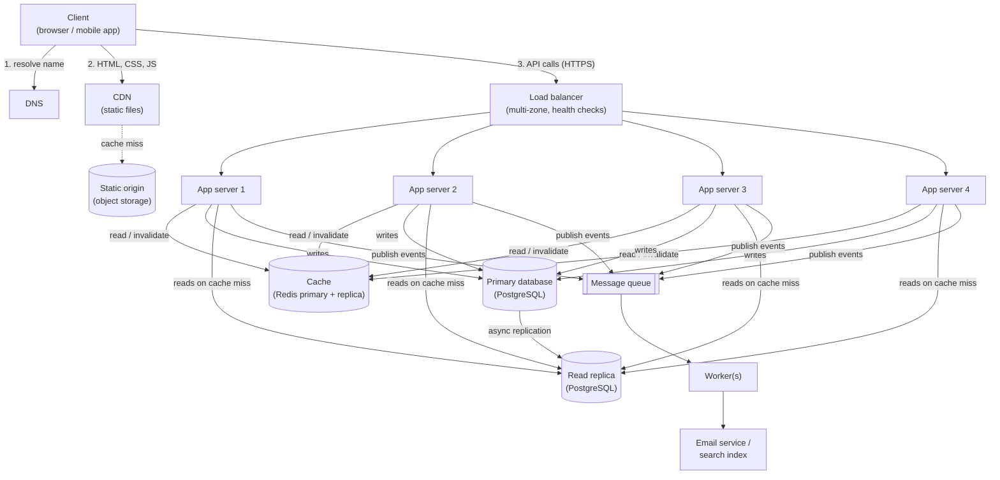

# QuickNotes System Architecture

QuickNotes is moving from a browser-only app to an online service for **1 million users**. This document sets out what the system must do, how much load to expect, the architecture that carries it, and the trade-offs behind it. It builds on [api-design.md](api-design.md) and [data-model.md](data-model.md).

---

## 1. Requirements

### 1.1 Functional requirements

| ID | The system must... |
|---|---|
| F1 | Let a person register and log in securely |
| F2 | Let a logged-in user create a note (title required, body and tags optional) |
| F3 | List a user's notes, newest first, with pagination |
| F4 | Show, edit (full or partial) and delete a single note |
| F5 | Let users tag notes and filter their notes by tag |
| F6 | Let users search their notes by text |
| F7 | Let one user open the same notes from several devices (phone and laptop) |
| F8 | Send a welcome / email-verification message after registration without slowing down the sign-up request |
| F9 | Keep every user's notes private: nobody can read or change another user's notes |

### 1.2 Non-functional requirements

| Quality | Target |
|---|---|
| **Availability** | 99.9% uptime (about 8.8 hours of downtime per year at most); no single component failure may take the service down |
| **Latency** | 95% of API reads under 300 ms and of writes under 500 ms, measured at the server |
| **Durability** | Saved notes are never lost: continuous backup with point-in-time recovery; recovery point of a few minutes at worst, recovery time under 30 minutes |
| **Scalability** | Handle today's estimated peak and grow 10x by adding servers, without redesign |
| **Consistency** | A user must see their own changes immediately ("read your own writes"); a few seconds of delay before changes appear in other views is acceptable |
| **Security** | HTTPS everywhere, salted password hashes, tokens that expire, per-user access checks on every query, rate limiting |
| **Efficiency on mobile networks** | Small, paginated, compressed responses so the app stays usable on slow or costly mobile data; serve static files from a CDN with nearby points of presence |
| **Observability** | Metrics, logs with a `request_id`, and alerts on error rate, latency and queue backlog |

---

## 2. Load estimate for 1 million users

### 2.1 Assumptions

| Assumption | Value |
|---|---|
| Registered users | 1,000,000 |
| Daily active users (DAU) | 20% = **200,000** |
| Reads per active user per day (open the app, list, open a note, search) | 50 |
| Writes per active user per day (create, edit, delete) | 5 (of which 2 are new notes) |
| Peak-to-average ratio (evening peak) | 5x |
| Average stored size of one note (text, tags, metadata) | about 1.2 KB |
| Index overhead on top of the row data | about 30% |
| Average read response | about 10 KB (a page of notes) |
| Cache hit ratio for reads | 80% |

### 2.2 Results

| Quantity | Calculation | Result |
|---|---|---|
| Reads per day | 200,000 x 50 | 10,000,000 |
| **Reads per second (average)** | 10,000,000 / 86,400 s | **about 116 / s** |
| **Reads per second (peak)** | 116 x 5 | **about 580 / s** |
| Writes per day | 200,000 x 5 | 1,000,000 |
| **Writes per second (average)** | 1,000,000 / 86,400 s | **about 12 / s** |
| **Writes per second (peak)** | 12 x 5 | **about 58 / s** |
| New notes per year | 200,000 x 2 x 365 | 146,000,000 |
| **Storage per year (data)** | 146,000,000 x 1.2 KB | **about 175 GB** |
| Storage per year (with indexes) | 175 GB x 1.3 | **about 230 GB** |
| Peak outgoing bandwidth | 580 reads/s x 10 KB | about 5.8 MB/s (46 Mbps) |
| Database reads at peak after cache | 580 x (1 - 0.8) | about 116 / s |
| Peak total API requests | 580 + 58 | about 640 / s |

**What the numbers tell us:** the system is read-heavy (about 10 reads for every write), so a cache and a read replica pay off. The load is modest in raw terms (under 1,000 requests per second), so the main reasons for this architecture are **reliability and room to grow**, not raw speed. Storage grows by roughly 230 GB per year, which is easily handled by one primary database plus a replica; both hold a full copy, so budget about 0.5 TB for the first year plus backups.

**Sizing:** if one app server comfortably handles about 200 requests per second, peak load needs about 4 servers (640 / 200 = 3.2, rounded up). Run **4 app servers, 2 in each of two availability zones**, so losing a whole zone still leaves capacity for normal traffic while autoscaling adds more.

---

## 3. Architecture diagram



The same diagram as plain text, for viewers that do not render Mermaid:

```
 Client (browser / mobile app)
   |-- 1. DNS lookup ----------> DNS
   |-- 2. static files --------> CDN ---(cache miss)---> Static origin (object storage)
   |-- 3. API calls (HTTPS)
   v
 Load balancer (multi-zone, health checks)
   |             |              |              |
   v             v              v              v
 App server 1  App server 2  App server 3  App server 4      (stateless, 2 per zone)
   |   |   |       |  (every app server talks to every component below)
   |   |   |
   |   |   +--- publish events ---> Message queue ---> Worker(s) ---> Email service / search index
   |   |
   |   +--- read / invalidate ---> Cache (Redis primary + replica)
   |
   +--- writes ---------------------> Primary database (PostgreSQL)
   |                                        |
   |                                        | async replication
   |                                        v
   +--- reads on cache miss ---------> Read replica (PostgreSQL)
```

---

## 4. What each component does

| Component | The problem it solves |
|---|---|
| **Client** | Gives the person an interface (web page or mobile app) and keeps requests small and paginated so it works on slow mobile networks. |
| **DNS** | Turns the human-friendly name `api.quicknotes.example` into the IP address of the load balancer, and lets us move or add servers without telling users. |
| **CDN** | Serves static files (HTML, CSS, JavaScript, images) from edge locations close to the user, so pages load fast and our servers never handle that traffic. |
| **Load balancer** | Spreads requests across the app servers, stops sending traffic to unhealthy ones, and gives clients one stable address, so no single app server is a bottleneck or a single point of failure. |
| **App servers (4, stateless)** | Run the API logic (validation, authentication, authorization); because they keep no session data in memory, any server can answer any request and we scale by simply adding more. |
| **Cache (Redis)** | Keeps recent query results in memory so most reads (about 80%) never touch the database, cutting latency and database load. |
| **Primary database** | The single source of truth: it accepts all writes with transactions, constraints and durable storage, so notes are never lost or corrupted. |
| **Read replica** | Holds a near-real-time copy of the primary and answers read queries that miss the cache, so reads do not compete with writes, and it can be promoted if the primary fails. |
| **Message queue** | Lets the API hand slow or non-urgent jobs (emails, search indexing) to a safe, durable line and answer the user immediately, even when those jobs are slow or temporarily failing. |
| **Worker** | Takes jobs from the queue and does the slow work in the background, retrying on failure, so the request that triggered it never has to wait. |

---

## 5. Request flows

### 5.1 `GET /v1/notes` (list notes)

1. The client looks up `api.quicknotes.example` through **DNS** and receives the load balancer's address. (Static files such as the page itself come from the **CDN**; API responses are private to each user, so they are never cached on the CDN.)
2. The client sends `GET /v1/notes?limit=20` over HTTPS with its `Authorization: Bearer ...` token.
3. The **load balancer** ends the TLS connection, checks which app servers are healthy, and forwards the request to one of them.
4. The **app server** verifies the token and rate limit, and reads the user id from the token.
5. It builds a cache key from the user id, filters and cursor (for example `notes:u7:tag=none:cursor=none`) and asks the **cache**.
6. **Cache hit (about 80% of the time):** the app server returns the cached JSON immediately with `200 OK`.
7. **Cache miss:** the app server runs the list query on the **read replica**, which uses the `(user_id, id DESC)` index.
8. The app server stores the result in the cache with a short expiry (for example 60 seconds), then returns `200 OK` with the notes and the `next_cursor`.

### 5.2 `POST /v1/notes` (create a note)

1. DNS resolution and the HTTPS connection to the **load balancer** happen as above; the request carries the token and the JSON body `{ "title": ..., "body": ..., "tags": [...] }`.
2. The load balancer forwards it to a healthy **app server**.
3. The app server verifies the token and rate limit, then **validates the input** (title required, 1-100 characters, body and tag limits). Invalid input returns `400` and nothing is saved.
4. In **one transaction on the primary database** it inserts the note, creates any new tags and adds the `note_tags` rows. The primary is used for all writes.
5. The app server **invalidates** the user's cached list keys (by deleting them or bumping a per-user version number), so the next list does not show stale data.
6. It **publishes a `note.created` event** to the **message queue** (a small JSON message with the note id and user id).
7. It immediately returns **`201 Created`** with a `Location` header and the new note in the body. The client does not wait for anything in the next steps.
8. A **worker** takes the event from the queue and does the background work: updating the search index and any notification. If a job fails it is retried with increasing delays and, after several failures, moved to a dead-letter queue for investigation. Jobs are written to be safe to run twice (idempotent), because queues deliver "at least once".
9. The primary **asynchronously replicates** the new row to the read replica, usually within milliseconds to a few seconds.

---

## 6. Trade-offs

| # | Decision | What we gain | What we give up | How we reduce the cost |
|---|---|---|---|---|
| 1 | **Cache + asynchronous read replica** (eventual consistency) | Fast reads (80% from memory), the primary is protected, and reads scale by adding replicas | A user might briefly see old data: the cache can be stale, and the replica can lag behind the primary | Invalidate the cache on every write; return the created or updated note in the write response so the client can show it at once; for a few seconds after a user writes, route that user's reads to the primary ("read your own writes") |
| 2 | **One SQL primary** instead of a sharded or NoSQL database | Simple, strongly consistent, real transactions and joins, easy to operate | All writes go through one machine, so write capacity is limited by that machine | The estimate is only about 58 writes per second at peak, far below what one PostgreSQL primary can do; if it ever grows, partition by `user_id` (every query already filters on it) |
| 3 | **Queue and workers** for emails and indexing instead of doing them inside the request | Fast responses, and a slow email provider cannot break note saving; failed jobs are retried | More moving parts to run and monitor; events are delivered at least once and may arrive late or twice | Idempotent workers, retries with backoff, a dead-letter queue and an alert on queue backlog |
| 4 | **Stateless app servers** with the session in the token | Any server can answer any request, so scaling and recovery are trivial | A token cannot be revoked instantly | Short token lifetime (1 hour) plus refresh, with a small deny-list in the cache for stolen tokens |
| 5 | **Running 2 zones with spare capacity** | Survives losing a server or a whole zone | Pays for servers that are not at full load most of the time | Autoscale on CPU and request rate so extra servers exist only when needed |

---

## 7. Avoiding single points of failure

A single point of failure (SPOF) is any component whose failure stops the whole service. Each layer is therefore duplicated:

| Layer | Why it could be a SPOF | How we avoid it |
|---|---|---|
| **DNS** | If it is down nobody can find the service | Use a managed DNS provider that runs many name servers in different places, with a low TTL so addresses can be changed quickly |
| **CDN** | If one edge fails, static files disappear | CDNs serve from many edge locations and re-route automatically; the origin storage is replicated |
| **Load balancer** | All traffic passes through it | Use a managed load balancer that is itself spread over two zones (or an active/standby pair with a floating address), with health checks |
| **App servers** | A crash or a bad deploy could stop the API | At least 2 (we run 4) in two zones, all identical and stateless; unhealthy servers are removed automatically; deploy one at a time (rolling) |
| **Cache** | If it dies, every read hits the database | Redis with a replica and automatic failover; if the cache is unreachable the app servers fall back to the database, with short rate limits and request coalescing so the database is not overwhelmed |
| **Primary database** | Losing it stops all writes and risks data loss | Automatic failover: the read replica (ideally in the other zone) is promoted to primary and the app servers reconnect; continuous backup (base snapshots plus write-ahead log archiving to storage in another region) allows point-in-time recovery; a new replica is rebuilt afterwards. Because replication is asynchronous, the last moments before a crash could be lost, which a synchronous standby can remove at some cost in write latency |
| **Read replica** | If it dies, cache misses have nowhere to go | Reads fall back to the primary temporarily (which has plenty of headroom at about 116 reads per second); a new replica is created |
| **Message queue** | If it is down, background jobs are lost | Use a managed, replicated queue with durable messages; if publishing fails, the API still returns success for the note and the event is retried (an outbox table written in the same transaction is the most robust version) |
| **Workers** | A crash could stop background work | Run at least 2; unfinished jobs return to the queue automatically |
| **People and process** | One person or one region is a hidden SPOF | Runbooks, alerts, tested restores (a backup is only real once it has been restored), and the ability to rebuild the whole stack from scripts |

---

## 8. Growth path

If QuickNotes grows 10x (10 million users), the design scales without a redesign: add app servers behind the load balancer, add read replicas, enlarge the cache, and add more workers. If write volume or data size eventually exceeds one primary, partition the data by `user_id` across several database clusters, and move search to a dedicated search service fed by the same queue.
