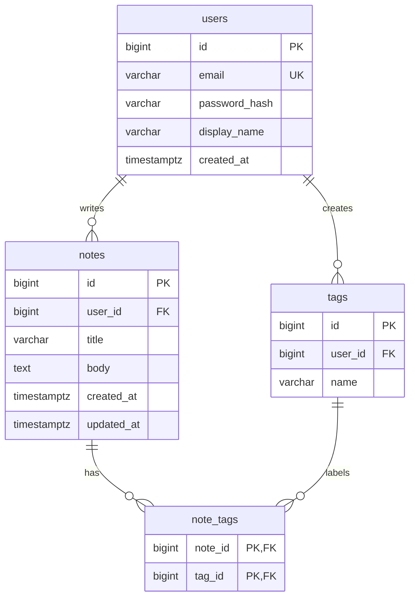

# QuickNotes Data Model

This document defines the database that sits behind the QuickNotes API described in [api-design.md](api-design.md). The SQL is written for **PostgreSQL**.

## 1. Entities at a glance

| Entity | Purpose |
|---|---|
| `users` | One row per registered person; owns notes and tags |
| `notes` | The notes themselves (title, body, timestamps) |
| `tags` | Labels a user creates, such as "shopping" or "lectures" |
| `note_tags` | Junction table linking notes to tags (many-to-many) |

### Entity-relationship diagram



---

## 2. Tables, columns and keys

### 2.1 `users`

| Column | Type | Key / constraint | Notes |
|---|---|---|---|
| `id` | `BIGINT` | **Primary key**, auto-generated | |
| `email` | `VARCHAR(255)` | `UNIQUE`, `NOT NULL` | Stored in lowercase; used to log in |
| `password_hash` | `VARCHAR(255)` | `NOT NULL` | Argon2id/bcrypt hash, never the password |
| `display_name` | `VARCHAR(100)` | nullable | |
| `created_at` | `TIMESTAMPTZ` | `NOT NULL`, default `now()` | |

### 2.2 `notes`

| Column | Type | Key / constraint | Notes |
|---|---|---|---|
| `id` | `BIGINT` | **Primary key**, auto-generated | |
| `user_id` | `BIGINT` | **Foreign key** -> `users(id)`, `NOT NULL`, `ON DELETE CASCADE` | The owner |
| `title` | `VARCHAR(100)` | `NOT NULL`, must not be blank | Matches the 100-character rule in the API |
| `body` | `TEXT` | `NOT NULL`, default `''`, max 10,000 characters | Optional in the API, so empty by default |
| `created_at` | `TIMESTAMPTZ` | `NOT NULL`, default `now()` | |
| `updated_at` | `TIMESTAMPTZ` | `NOT NULL`, default `now()` | Set again on every edit |

### 2.3 `tags`

| Column | Type | Key / constraint | Notes |
|---|---|---|---|
| `id` | `BIGINT` | **Primary key**, auto-generated | |
| `user_id` | `BIGINT` | **Foreign key** -> `users(id)`, `NOT NULL`, `ON DELETE CASCADE` | Tags belong to one user |
| `name` | `VARCHAR(50)` | `NOT NULL`, `UNIQUE (user_id, name)` | A user cannot have two tags with the same name |

### 2.4 `note_tags` (junction table)

| Column | Type | Key / constraint | Notes |
|---|---|---|---|
| `note_id` | `BIGINT` | **Foreign key** -> `notes(id)`, `ON DELETE CASCADE`; part of the composite **primary key** | |
| `tag_id` | `BIGINT` | **Foreign key** -> `tags(id)`, `ON DELETE CASCADE`; part of the composite **primary key** | |

The composite primary key `(note_id, tag_id)` stops the same tag being attached to the same note twice.

---

## 3. Relationships

| Relationship | Type | How it is stored |
|---|---|---|
| `users` -> `notes` | **One-to-many** | One user writes many notes; each note has exactly one owner, so `notes.user_id` is a foreign key to `users.id` |
| `users` -> `tags` | **One-to-many** | One user creates many tags; each tag has one owner, via `tags.user_id` |
| `notes` <-> `tags` | **Many-to-many** | One note can carry many tags, and one tag can label many notes. A single foreign key cannot express this, so the junction table `note_tags` holds one row per (note, tag) pair |

**Deleting data:** `ON DELETE CASCADE` keeps the database clean. Deleting a note removes its `note_tags` rows; deleting a tag removes its links but keeps the notes; deleting a user removes everything they own.

**Integrity note:** the foreign keys do not by themselves stop a link between *one user's* note and *another user's* tag. The API prevents this by always filtering with the user id from the access token. If the team wants the database to enforce it too, add `user_id` to `note_tags` with composite foreign keys.

---

## 4. CREATE TABLE statements

```sql
CREATE TABLE users (
    id            BIGINT GENERATED ALWAYS AS IDENTITY PRIMARY KEY,
    email         VARCHAR(255) NOT NULL UNIQUE,
    password_hash VARCHAR(255) NOT NULL,
    display_name  VARCHAR(100),
    created_at    TIMESTAMPTZ  NOT NULL DEFAULT now()
);

CREATE TABLE notes (
    id         BIGINT GENERATED ALWAYS AS IDENTITY PRIMARY KEY,
    user_id    BIGINT       NOT NULL REFERENCES users (id) ON DELETE CASCADE,
    title      VARCHAR(100) NOT NULL CHECK (length(btrim(title)) > 0),
    body       TEXT         NOT NULL DEFAULT '' CHECK (length(body) <= 10000),
    created_at TIMESTAMPTZ  NOT NULL DEFAULT now(),
    updated_at TIMESTAMPTZ  NOT NULL DEFAULT now()
);

CREATE TABLE tags (
    id      BIGINT GENERATED ALWAYS AS IDENTITY PRIMARY KEY,
    user_id BIGINT      NOT NULL REFERENCES users (id) ON DELETE CASCADE,
    name    VARCHAR(50) NOT NULL,
    UNIQUE (user_id, name)
);

CREATE TABLE note_tags (
    note_id BIGINT NOT NULL REFERENCES notes (id) ON DELETE CASCADE,
    tag_id  BIGINT NOT NULL REFERENCES tags (id)  ON DELETE CASCADE,
    PRIMARY KEY (note_id, tag_id)
);
```

---

## 5. Indexes

```sql
-- Serves "list my notes, newest first" and the cursor pagination in GET /v1/notes
CREATE INDEX idx_notes_user_id_id_desc ON notes (user_id, id DESC);

-- Serves "find all notes with this tag" (the primary key only helps the other direction)
CREATE INDEX idx_note_tags_tag_id_note_id ON note_tags (tag_id, note_id);
```

| Index | Reason |
|---|---|
| `idx_notes_user_id_id_desc` | Almost every request is "the latest notes for *this* user". Without this index PostgreSQL would scan the whole `notes` table (about 146 million rows after one year, see [architecture.md](architecture.md)) for every page. With it, the database jumps straight to one user's newest rows and stops after `LIMIT` rows. Ids increase over time, so `id DESC` is newest-first, and the API's `cursor` is simply the last `id` seen. |
| `idx_note_tags_tag_id_note_id` | The primary key `(note_id, tag_id)` is fast for "which tags does this note have?" but cannot answer "which notes have this tag?" efficiently. This reverse index makes the tag filter in `GET /v1/notes?tag=...` and the tag counts fast. |

Already indexed automatically: `users.email` (unique constraint) and `tags (user_id, name)` (unique constraint, used to look up a tag by name).

**Later:** when search (`q`) becomes heavy, add a PostgreSQL full-text index (a `GIN` index on `to_tsvector('simple', title || ' ' || body)`), or move search to a dedicated search service fed by the queue.

---

## 6. Example queries

`$1`, `$2`... are parameters supplied by the application (prepared statements), which also protects against SQL injection.

**Query 1 - List a user's latest notes (page 2 onwards uses the cursor)**

```sql
SELECT id, title, body, created_at, updated_at
FROM   notes
WHERE  user_id = $1
  AND  id < $2            -- cursor: last id of the previous page
ORDER  BY id DESC
LIMIT  20;
```

**Query 2 - JOIN: notes that carry a given tag, with the tags themselves**

```sql
SELECT n.id,
       n.title,
       n.created_at,
       array_agg(t2.name ORDER BY t2.name) AS tags
FROM   notes n
JOIN   note_tags nt ON nt.note_id = n.id
JOIN   tags t       ON t.id = nt.tag_id AND t.name = $2
JOIN   note_tags nt2 ON nt2.note_id = n.id
JOIN   tags t2      ON t2.id = nt2.tag_id
WHERE  n.user_id = $1
GROUP  BY n.id, n.title, n.created_at
ORDER  BY n.id DESC
LIMIT  20;
```

**Query 3 - JOIN with aggregation: how many notes does each tag have?**

```sql
SELECT t.id, t.name, COUNT(nt.note_id) AS note_count
FROM   tags t
LEFT   JOIN note_tags nt ON nt.tag_id = t.id
WHERE  t.user_id = $1
GROUP  BY t.id, t.name
ORDER  BY note_count DESC, t.name;
```

**Query 4 - Create a note and attach a tag, in one transaction**

```sql
BEGIN;

INSERT INTO notes (user_id, title, body)
VALUES ($1, $2, $3)
RETURNING id, created_at;

INSERT INTO tags (user_id, name)
VALUES ($1, $4)
ON CONFLICT (user_id, name) DO UPDATE SET name = EXCLUDED.name
RETURNING id;

INSERT INTO note_tags (note_id, tag_id)
VALUES ($5, $6);          -- ids returned by the two statements above

COMMIT;
```

**Query 5 - Update and delete, always scoped to the owner**

```sql
UPDATE notes
SET    body = $3, updated_at = now()
WHERE  id = $1 AND user_id = $2
RETURNING id, title, body, updated_at;

DELETE FROM notes
WHERE  id = $1 AND user_id = $2;   -- note_tags rows disappear via ON DELETE CASCADE
```

If either statement affects zero rows, the API returns `404`, whether the note does not exist or belongs to someone else.

---

## 7. SQL or NoSQL?

**Decision: a relational SQL database (PostgreSQL).** QuickNotes data is naturally relational: users own notes and tags, and notes and tags form a many-to-many relationship that SQL handles cleanly with a junction table, `JOIN`s and foreign keys that the database itself enforces (no orphaned links, no duplicate emails). Creating a note together with its tags must succeed or fail as a whole, which is what ACID transactions guarantee, and users expect to see their own note immediately after saving it. The workload is also modest for a modern relational database: about 12 writes per second on average and a few hundred reads per second at peak for 1 million users, with 80% of reads absorbed by the cache. A single PostgreSQL primary with a read replica handles that comfortably, while the team gets mature tooling, backups and point-in-time recovery. The trade-off is that SQL scales writes less easily than many NoSQL systems; if QuickNotes grows far beyond this, the data partitions neatly by `user_id` (every query already filters on it), so it can be sharded later, or a NoSQL store can be added for specific features such as full-text search, without rewriting the core model.
